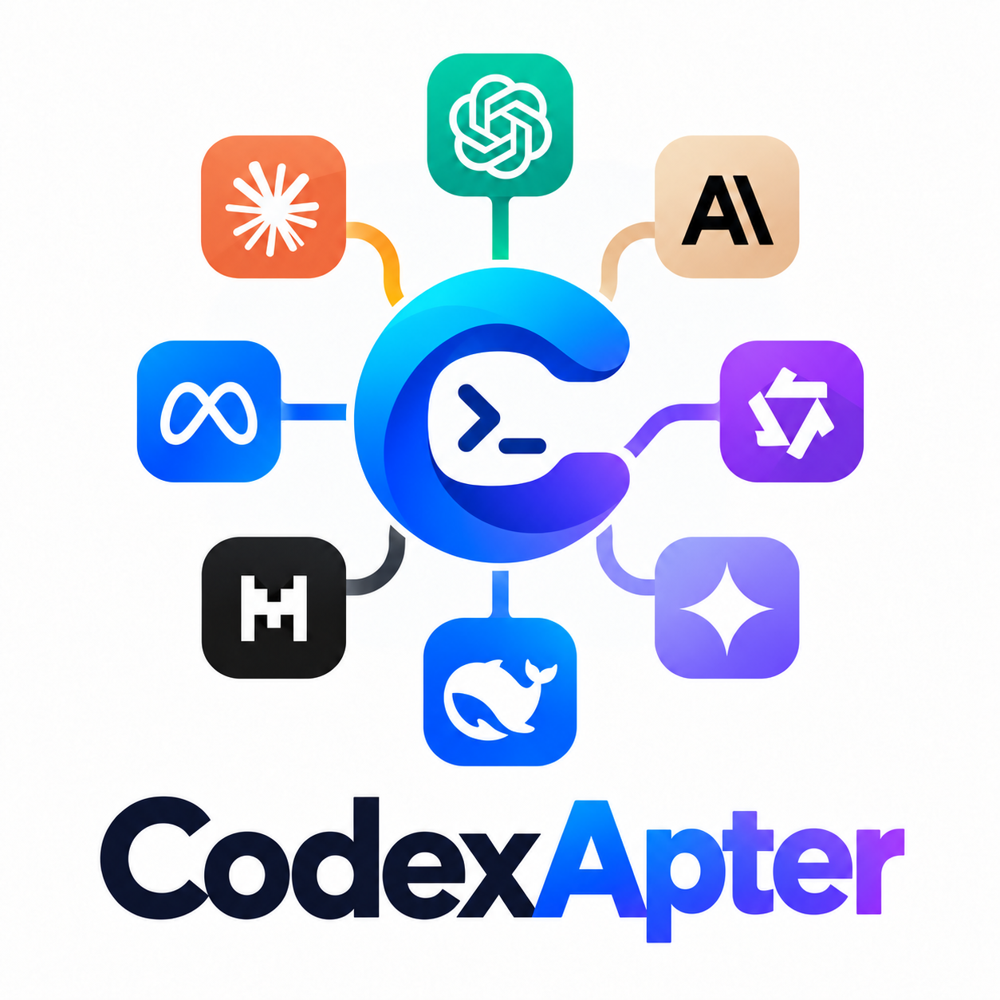
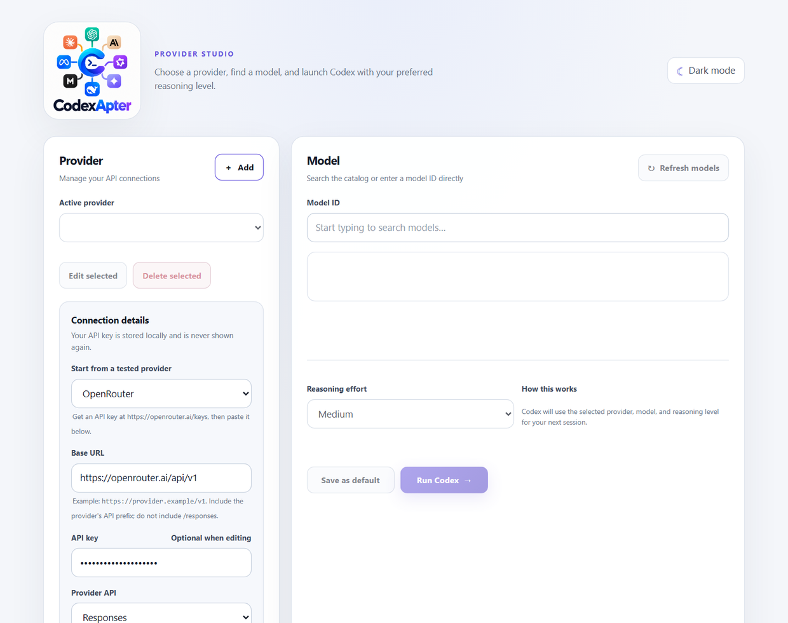
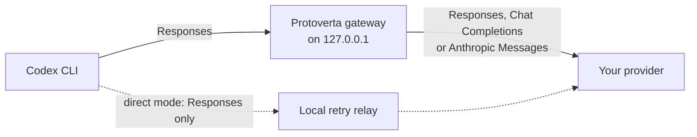

<div align="center">
  <picture>
    <source media="(prefers-color-scheme: dark)" srcset="assets/CodexApter_black.png">
    
  </picture>
  <p><strong>A clean, focused way to connect Codex to the model provider you choose.</strong></p>
  <p>Manage providers, find models, choose a reasoning level, and launch Codex from one local setup studio.</p>
  <p>
    <a href="LICENSE"></a>
    
    
    <a href="https://github.com/HaianCao/CodexApter/actions/workflows/ci.yml"></a>
    <a href="https://github.com/HaianCao/Protoverta"></a>
  </p>
  <p><a href="#quick-start">Quick start</a> &middot; <a href="#configure-a-provider">Providers</a> &middot; <a href="#use-codexapter">CLI</a> &middot; <a href="#privacy-and-security">Security</a></p>
</div>

---

CodexApter is a lightweight launcher and configuration studio for the official Codex CLI. It lets you connect compatible API providers, choose a model and reasoning effort, and start Codex with those settings without replacing or modifying the Codex CLI itself.

## What you can do

- Save and switch between multiple providers in a local browser-based setup page.
- Search a provider's model catalog as you type, or enter a model ID manually.
- Choose a default provider, model, and reasoning effort for future sessions.
- Add, edit, and remove provider connections, and switch between light and dark themes.
- Launch Codex in the current terminal, or select a different provider/model for one run.
- Manage API keys locally without putting them in the provider configuration file.

Responses providers connect directly by default. An opt-in local [Protoverta](https://github.com/HaianCao/Protoverta) gateway translates supported text, user image inputs and function tools from Chat Completions or Anthropic Messages into Responses; unsupported requests fail explicitly. Model discovery through `GET /models` is optional, and model IDs can be entered manually.

## Quick start

### Windows

In PowerShell, run the installer directly from GitHub. No repository clone is needed:

```powershell
& ([scriptblock]::Create((irm "https://raw.githubusercontent.com/HaianCao/CodexApter/main/scripts/install.ps1")))
```

The installer sets up CodexApter and its local Protoverta gateway for your Windows account. It can install Python 3.11+ with `winget` if needed and installs the official Codex CLI only if it is missing. It does not require administrator access. Run the same command again to update; your providers and API keys are kept.

Open a new terminal and run:

```powershell
codex-ca
```

The first time, this opens the setup page in your browser (later, `codex-ca setup` opens it). Paste your provider's base URL and API key, choose the API it speaks, pick a model and select **Run Codex**. That is all: authentication, the connection mode, the model's context window and retries are set up automatically.

Windows supports native CLI executables and standard npm global or project installations. Custom batch-wrapper behavior is not supported; use an official CLI installation if the launcher cannot resolve it safely.

### Linux and macOS

In a terminal, run the installer directly from GitHub:

```bash
curl -fsSL https://raw.githubusercontent.com/HaianCao/CodexApter/main/scripts/install.sh | bash
```

It needs Python 3.11+ with `venv` (on Debian/Ubuntu: `sudo apt install python3 python3-venv`; on macOS: `brew install python@3.13`), installs the official Codex CLI with its own installer only if it is missing, and puts `codex-ca` in `~/.local/bin` (added to your shell profile if needed). No `sudo` is used. Run the same command again to update; your providers and API keys are kept. Settings live in `~/.config/codexapter` and the model cache in `~/.cache/codexapter` (or under `$XDG_CONFIG_HOME` / `$XDG_CACHE_HOME`).

Open a new terminal and run `codex-ca`; setup works as on Windows.

## Configure a provider

<p align="center"></p>

In the setup page:

1. Select **Add**. For **OpenRouter**, **NVIDIA NIM**, **TokenHarbor** or **AgentRouter**, pick it under *Start from a tested provider*; otherwise leave *Custom provider*.
2. Paste the **Base URL** (for example `https://api.example.com/v1`, without `/responses` or `/chat/completions`) and your **API key**.
3. Choose the **API** your provider speaks: Responses, Chat Completions or Anthropic Messages.
4. Select **Save provider**. Setup checks the key without generating anything (no cost), uses `Authorization: Bearer` or, if the provider needs it, `x-api-key` through the local gateway, and tells you if the key is rejected or the address has no such API.
5. Pick a model from the list (or type its ID), choose a reasoning effort, then **Save as default** or **Run Codex**.

The provider's name and ID come from its address; change them, the authentication or the gateway choice under **Advanced: connection details** if you need to.

### How CodexApter connects



| | Local gateway (default) | Direct |
|---|---|---|
| Path | Codex → Protoverta on your computer → provider | Codex → provider |
| Provider APIs | Responses, Chat Completions, Anthropic Messages (translated) | Responses only |
| Extras | Retries by error class, stream checks, keep-alives, clear errors, `x-api-key` providers | Retries by a small local relay |
| When to choose | Almost always | Providers that only accept the official Codex client (AgentRouter); set automatically |

Your key stays on your computer in both cases. Switch under **Advanced: connection details**, or set `execution_mode = "direct"` or `"gateway"` for the provider in the configuration file. Providers saved by CodexApter 0.1 keep the mode they had.

When you choose **Run Codex**, the setup page closes and Codex takes over the terminal where you launched `codex-ca setup`. Direct mode supplies the provider key; gateway mode supplies a temporary local token and keeps the upstream key in the launcher.

**Run Codex** uses the current selection for this session. Choose **Save as default** explicitly to change future launches. Model lists are discovery data; the setup page reports local route evidence separately, and manual model IDs remain available if discovery fails.

### Gateway details

Reasoning compatibility is automatic for new providers. The launcher preserves
portable public reasoning (Chat `reasoning_content` or OpenRouter `reasoning`)
as Responses `reasoning_text`, keeps each model's default reasoning, and
explicitly omits reasoning output that cannot be represented (for example
OpenRouter `reasoning_details` or Messages thinking blocks). Nothing is shown
as answer text or fabricated. Manual overrides remain under **Advanced:
reasoning settings**.

The **model context window** is passed to Codex as `model_context_window`, so
auto-compaction matches the model's real window. It is taken automatically from
the selected model's maximum when the provider reports it in its model list
(OpenRouter and TokenHarbor do; NVIDIA NIM does not); a value you enter under
**Model limits** on a provider always wins. Messages providers default to a 16384-token output
limit (previously 4096, which truncated long edits).

How the gateway converts each protocol, its options and limits: [Protoverta documentation](https://haiancao.github.io/Protoverta/). Tested providers (OpenRouter, NVIDIA NIM, TokenHarbor, AgentRouter), their known limits and recommended settings: [provider compatibility](https://github.com/HaianCao/Protoverta/blob/main/docs/compatibility/providers.md).

CodexApter **0.3.1** installs [Protoverta](https://github.com/HaianCao/Protoverta) **0.4.0**; the installer verifies the gateway wheel's SHA-256 before installing it.

Under **Advanced: model compatibility checks**, you can select a local capability
registry file and require verified capabilities. Relative paths start at the
configuration folder. Unsupported features are blocked before API calls; the
strict option also blocks missing records. Leave this optional section empty
unless you maintain capability records for your provider's exact API prefix and
model IDs. Basic launch capabilities are checked before setup closes; tools and
output formats are checked against each actual request.

Cross-protocol mode supports text, function tools and `low`/`medium`/`high` effort when the model supports it. The launcher requests web search, multi-agent execution and reasoning summaries to be disabled for translated sessions. Session history may still advertise old function tools; supported namespace functions are mapped by the gateway. Hidden reasoning history does not transfer between protocols. For Messages providers, the default output limit is 16384 tokens when Codex supplies no limit; this is adjustable in setup.

Responses function namespaces are mapped to reversible aliases for Chat/Messages;
native Responses forwarding is unchanged. In a Messages provider's advanced
settings, exact model IDs can opt into provider-verified mid-conversation system
support. Leave this empty unless support is confirmed. Instruction positions
are preserved, so incompatible Codex model-switch histories still fail instead
of being silently rewritten. Resume compatibility depends on the actual history
and provider, not only on the selected endpoint.

## Use CodexApter

```powershell
codex-ca                                      # launch using saved defaults
codex-ca setup                                # open the provider setup page
codex-ca run -p PROVIDER -m MODEL_ID          # choose a provider and model for this run
codex-ca exec -p PROVIDER -m MODEL_ID -- "Explain this repository"
codex-ca resume -p PROVIDER -- --last
codex-ca providers list
codex-ca models list -p PROVIDER
codex-ca doctor -p PROVIDER -m MODEL_ID
codex-ca --help
```

After installation, `codex-ca` is available from any working directory. Re-run the installer command to update CodexApter; your provider settings are retained. Updates are checked before activation, so a failed download or package preparation leaves the existing version usable.

## Automatic retry

When a provider fails a request with a temporary error, CodexApter waits and sends the same request again, so you see an error only when it keeps failing. In gateway mode Protoverta does this; in direct mode a small local relay does. A request is retried at one layer only.

| Retried (default) | Not retried (shown at once) |
|---|---|
| rate limits, overloaded or unavailable providers, server errors, network failures, streams that fail before any output, backend mismatches (for example "created under a different Azure OpenAI resource"), unrecognised errors | rejected key, no credit, unknown model, context too long, content policy, invalid request |

Output that already reached Codex is never sent again. Defaults: up to 10 retries about 60 s apart (± 20 %, at least the provider's `Retry-After`), 30 minutes at most. Press Esc in Codex to cancel; the wait stops too. Each decision, with the provider's error message, is written to `%LOCALAPPDATA%\codexapter\retry.log` (kept under about 1 MB).

To change this, add a `[retry]` table to `%APPDATA%\codexapter\config.toml` (every key is optional):

```toml
[retry]
enabled = true             # false: no retries
max_retries = 10           # 0-100
delay_seconds = 60         # 0-3600
jitter = 0.2               # fraction of the delay
max_total_seconds = 1800   # stop waiting after this long
retry_classes = []         # add classes, e.g. ["model_not_found"]
no_retry_classes = []      # remove classes, e.g. ["network"]
```

Classes: `rate_limit`, `overloaded`, `server`, `network`, `stream_interrupted`, `backend_mismatch`, `unknown` (retried by default) and `auth`, `billing`, `model_not_found`, `context_length`, `content_policy`, `invalid_request`. Network retries resend a request whose generation may already have started, which some providers bill; remove `network` if that matters to you.

## Troubleshooting

| What you see | What to do |
|---|---|
| "The provider rejected this API key" when saving | Paste the key again (without `Bearer `); check that it is active and has credit. |
| "This provider only accepts its official CLIs" | Expected for AgentRouter: it runs Direct and has no readable model list; type the model ID. |
| `401 Unauthorized: unauthorized client detected` when running | The provider (for example AgentRouter) accepts only the official Codex, which must reach it directly with the Responses API. Open setup, edit the provider and save it again: setup now picks Responses and Direct for such providers (or choose the AgentRouter preset). |
| "No model list" / the model list is empty | Type the exact model ID from the provider's website. |
| "This provider has no … endpoint at this address" or "answered with a web page" | Check the base URL (it usually ends in `/v1`) and the API you chose. |
| Requests fail after a long wait | Open `%LOCALAPPDATA%\codexapter\retry.log` to see the provider's error for each attempt. |
| "Protoverta component is missing or broken" | Run the installer command again; it repairs the installation and keeps your settings. |
| Behind a company proxy | Set `HTTPS_PROXY` (and `NO_PROXY` for local addresses); the local gateway is reached directly. |
| A provider needs custom headers or query parameters (for example Azure `api-version`) | Not supported yet; use an OpenAI- or Anthropic-compatible endpoint for that provider. |

## Uninstall

In PowerShell, run the uninstaller from GitHub:

```powershell
& ([scriptblock]::Create((irm "https://raw.githubusercontent.com/HaianCao/CodexApter/main/scripts/uninstall.ps1")))
```

It removes the launcher and its wrapper PATH entries, not the official Codex CLI. Separate prompts let you reset adapter environment overrides and delete default provider settings, API keys and cache (type `DELETE`). Everything is kept unless you confirm its removal.

Environment reset clears `CODEX_CA_CONFIG`, `CODEX_CA_CACHE`, `CODEX_CA_ENV_FILE`, `CODEX_CA_MCP_CONFIG`, `CODEX_CA_MODEL_CATALOG` and `CODEX_CA_ENABLE_SUBAGENTS` at user/process scope. It does not delete custom-path files, provider key variables, or shared `ANTHROPIC_*`/`OPENAI_*` variables. Machine-wide settings are not changed. Open a new terminal afterward. To explicitly request reset without prompts, append `-ResetEnvironment -NonInteractive`; data deletion still requires interactive confirmation.

On Linux and macOS:

```bash
curl -fsSL https://raw.githubusercontent.com/HaianCao/CodexApter/main/scripts/uninstall.sh | bash
```

It removes `codex-ca`, its environments and the PATH lines the installer added, not the official Codex CLI. Provider settings, API keys and the cache are kept; add `--delete-data` (`… | bash -s -- --delete-data`) to delete them too. Custom paths set through environment variables are never deleted.

## Advanced gateway settings

On the integration branch, gateway providers can choose Bearer (recommended) or
x-api-key authentication independently of protocol. Existing Messages configs
without an auth_mode keep their previous x-api-key behavior. New providers
default to Bearer; direct Codex connections use Bearer.

Optional advanced gateway policies support evidence-scoped provider profile
files, shared quota databases and bounded HTTP-rejection retries. Leave them
blank for existing behavior. These options and client tool-search emulation
require the pinned Protoverta release
(installed with the gateway preview). They do not enable hidden reasoning migration or model fallback.

## Privacy and security

Provider settings and API keys are stored on your computer. API keys are kept in a local `.env` file in plain text, so protect the file and never commit or share it. A key saved there takes precedence over an environment variable of the same name; the environment variable is used only when the file has no value. The setup page listens only on your own computer (`127.0.0.1`). Gateway mode (the default) starts a temporary Protoverta server on `127.0.0.1` and stops it when Codex exits; direct mode starts a small retry relay there instead. Neither adds credentials or stores conversation content; `retry.log` keeps only request paths and provider error messages.

Client interoperability is tested with scripted local upstreams and live checks of the tested providers; other providers and models can differ.

For Chat providers returning unsigned `reasoning_content`, automatic mode keeps
public reasoning separate from the answer and supports replay
as Responses `reasoning_text`. It does not convert summaries, encrypted state or
Messages signatures. Image inputs support URL/base64 user messages, not
provider-owned file IDs. Rich text/image tool results map Messages ↔ Responses;
Chat targets reject image tool results rather than moving them to user content.
Provider/model support still varies.

Provider IDs must produce distinct API-key variable names (`a-b` and `a_b`
both normalize to `A_B_TOKEN`). Setup rejects such collisions without changing
saved keys. To share a key intentionally, point both providers at the same
secret reference in TOML instead of defining duplicate environment mappings.

## Session tools

External stdio MCP servers can be selected for one launch with
`CODEX_CA_MCP_CONFIG`: a JSON file with `mcpServers`, each containing an absolute
executable `command`, optional `args`, and `env_vars` names. No global MCP
registration is changed. Keys belong in the named environment variables.
An optional `CODEX_CA_MODEL_CATALOG` selects an operator-supplied Codex catalog
matching the Codex CLI 0.166.0 ModelInfo schema (verified on **0.166.0** and **0.167.0**; newer 0.x releases warn) and the exact model ID. Required structure and
version are checked; capabilities are not inferred.

The integration preview can opt into one foreground subagent on translated
routes with `$env:CODEX_CA_ENABLE_SUBAGENTS = '1'` for the current shell.
This subset requires Codex CLI **0.166.0** or newer (verified on 0.166.0 and 0.167.0; newer releases warn) and provider `agent_models` policy
`selected` (same model) or `custom` (explicit child model and low/medium/high
effort). Every parent/child model needs its own exact entry in
`CODEX_CA_MODEL_CATALOG` with `supports_search_tool = false` and no code-only
tool mode. A custom child's effort must appear in its own
`supported_reasoning_levels`. Older configurations
remain disabled. Clear the opt-in with `Remove-Item Env:CODEX_CA_ENABLE_SUBAGENTS`.
This validates harness transport with local fixtures, not every provider/model.
Different-model child defaults and continuation of the same live child are
tested with local fixtures. Gateway mode rejects `resume_agent` for different
child models because Codex 0.166.0 can reopen the child with the parent model;
use `send_input` on a retained child or start a new child. This guard requires
gateway mode; direct native Responses follows Codex's own resume behavior.
Nested, detached and persisted child resume remain outside this subset.
The opt-in caps open child threads at one. Custom agent files and explicit
spawn model overrides retain harness precedence and are outside the tested
configured-default subset; no model override is silently rewritten.
Native Responses continues to use the harness's own agent settings.

## For contributors

```powershell
python -m pip install -e ".[test]"
python -m pytest
```

Pull requests and pushes are checked by the project's GitHub Actions workflow.

To test an unpublished Protoverta build, pass `-ProtovertaWheel PATH_TO_WHEEL` to the local installer; it is installed instead of the pinned, hash-verified release wheel.

Installer smoke tests can pass `-NoPathChanges` to install and uninstall scripts. Redirect `APPDATA` and `LOCALAPPDATA` in a disposable child shell as well: the flag alone does not isolate installation or user data paths.

## Gateway checks and diagnostics

Gateway previews provide route checks through `codex-ca doctor -p PROVIDER -m MODEL --allow-live --check text --check streaming --report NEW_REPORT.json`.
These checks may incur provider charges; without `--allow-live`, gateway doctor makes no provider requests.
Advanced setup can enable local session diagnostics, counting policies and evidence freshness checks. Diagnostics omit prompts and keys; reopen setup to view the last session report.

## License

CodexApter is licensed under the [MIT License](LICENSE).
