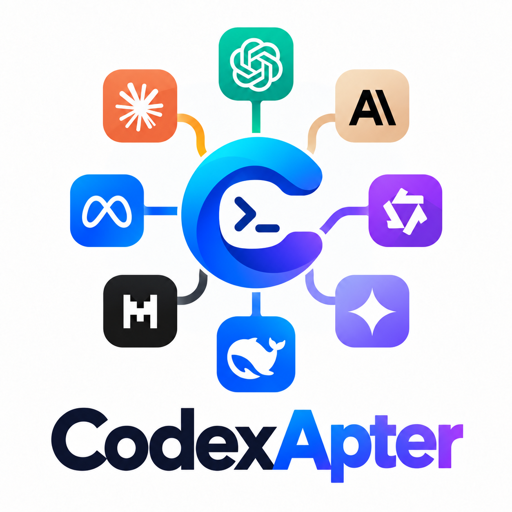

<div align="center">
  <picture>
    <source media="(prefers-color-scheme: dark)" srcset="assets/CodexAI_black.png">
    
  </picture>
  <p><strong>A clean, focused way to connect Codex to the model provider you choose.</strong></p>
  <p>Manage providers, discover models, tune reasoning, and launch Codex from one local setup studio.</p>
  <p>
    <a href="LICENSE"></a>
    
    
    <a href="https://github.com/HaianCao/free-codex-cli/actions/workflows/ci.yml"></a>
  </p>
  <p><a href="#quick-start">Quick Start</a> · <a href="#configure">Providers</a> · <a href="#use">CLI</a> · <a href="#data-and-security">Security</a></p>
</div>

---

`codex-ca` (CodexApter) lets you configure multiple API providers and launch Codex with your chosen provider, model, and reasoning level.

## Quick Start

## Install on Windows

Run this in PowerShell to download and install directly from GitHub without cloning the repository:

```powershell
& ([scriptblock]::Create((irm "https://raw.githubusercontent.com/HaianCao/free-codex-cli/main/scripts/install.ps1")))
```

The installer downloads the project source and installs the required tools for your Windows account. It does not automatically open CodexApter or the setup page. Open a new terminal and run `codex-ca setup` when you are ready to configure a provider and API key. You can also run `scripts/install.ps1` from a local checkout.

Run the same command again any time to update CodexApter to the latest code on GitHub. The installer migrates the previous wrapper and user data, then removes the old wrapper/PATH entry after the new command is installed. Configuration and API keys move from `%APPDATA%\codex-ai` to `%APPDATA%\codexapter`; the model cache moves from `%LOCALAPPDATA%\codex-ai` to `%LOCALAPPDATA%\codexapter`. Migration never overwrites files already at the new location. Codex CLI is not removed or reinstalled. Updates keep your existing settings and never open the setup page automatically.

To uninstall the CodexApter wrapper without cloning the repository, run this in PowerShell:

```powershell
& ([scriptblock]::Create((irm "https://raw.githubusercontent.com/HaianCao/free-codex-cli/main/scripts/uninstall.ps1")))
```

The uninstaller asks for confirmation, removes the `codex-ca` wrapper (and any previous dedicated `codex-ai` wrapper) and their user PATH entries, and keeps your configuration/API keys by default. It never removes Codex CLI. You can separately confirm deletion of provider settings and keys.

Requirements: Windows 10/11 and an internet connection. If Python 3.11+ is missing, the script uses `winget` to install it. The script does not require administrator access or change the system-wide PATH.

## Configure

In the browser page:

1. Add a provider name and its API base URL, such as `https://api.example.com/v1`.
2. Enter your API key.
3. Refresh the model list, or type a model ID manually.
4. Choose a default model and reasoning level, then save.

The provider must support the OpenAI Responses API (`/responses`). This project does not convert Chat Completions or Anthropic Messages requests into Responses.

## Use

```powershell
codex-ca                         # launch with saved defaults
codex-ca setup                   # reopen configuration
codex-ca run -p PROVIDER -m MODEL
codex-ca exec -p PROVIDER -m MODEL -- "Explain this repository"
codex-ca resume -p PROVIDER -- --last
codex-ca providers list
codex-ca doctor -p PROVIDER -m MODEL
```

Run `codex-ca --help` for all commands. You can launch `codex-ca` from any directory after installation.

## Data and security

Configuration is stored under `%APPDATA%\codexapter` and the model catalog cache under `%LOCALAPPDATA%\codexapter` (on Windows). On other systems they use `~/.config/codexapter` and `~/.cache/codexapter`. API keys are stored in the config folder's `.env` file and are not written to TOML. The `.env` file contains plaintext secrets: do not share or commit it. Existing `codex-ai` data is migrated once on update/first launch. Optional path overrides are `CODEX_CA_CONFIG`, `CODEX_CA_CACHE`, and `CODEX_CA_ENV_FILE`. The setup page listens only on your own computer (`127.0.0.1`).

## Development

```powershell
python -m pip install -e ".[test]"
python -m pytest
```

The test suite runs automatically on Windows for pushes and pull requests. It checks the Python package and parses the installer/uninstaller with both Windows PowerShell 5.1 and PowerShell 7.

## License

This project is licensed under the MIT License. See [LICENSE](LICENSE).
